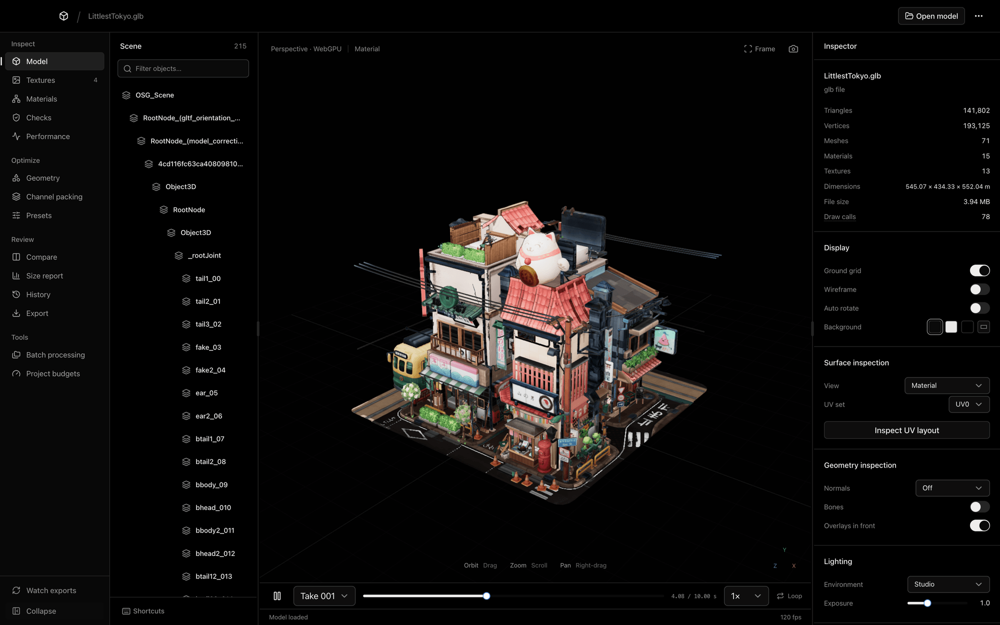
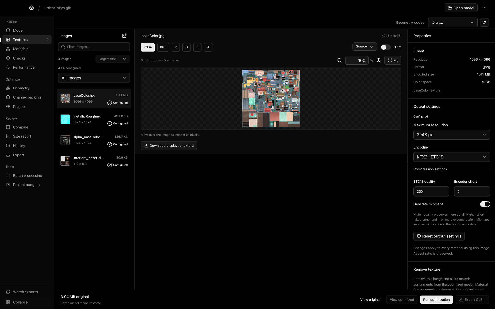
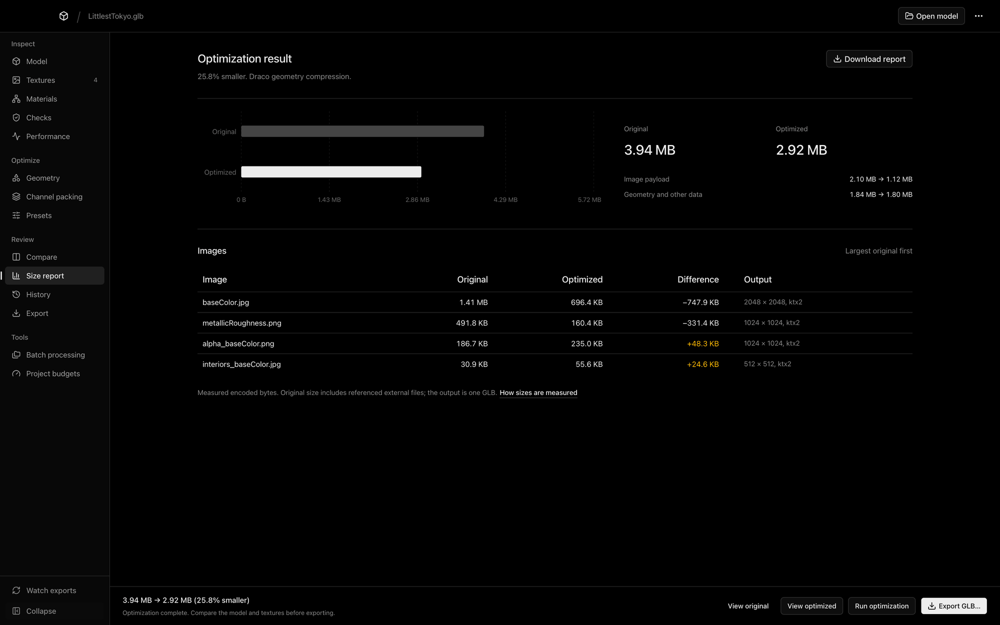
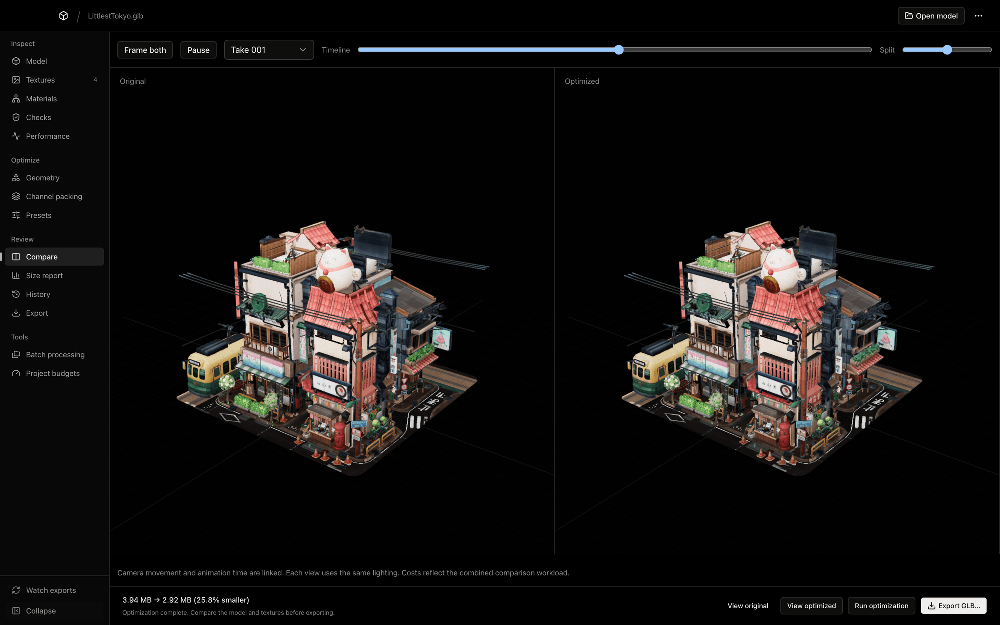
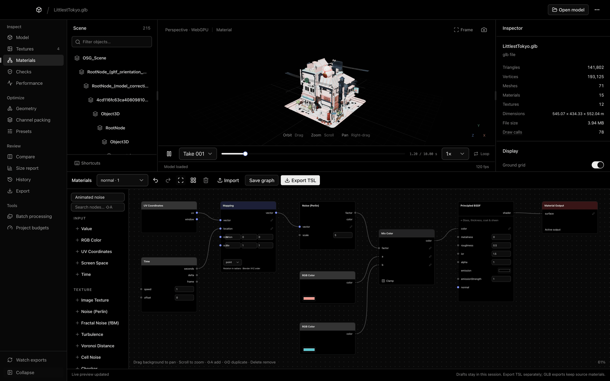
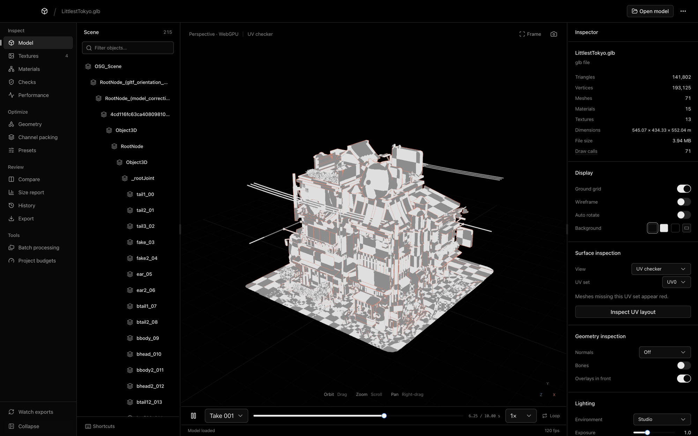

# GLB Viewer

**Shrink, inspect, and prepare GLB models for Three.js.** A local-first Mac app that compresses textures to KTX2, optimizes geometry, and shows exactly what changed. Your models never leave your computer.

[**Download for Mac**](https://github.com/cullenwebber/glb-viewer/releases/latest) · [User guide](docs/user-guide.md) · [Blender bridge](docs/blender-bridge.md)

## Install

1. Download the DMG from the [latest release](https://github.com/cullenwebber/glb-viewer/releases/latest): **arm64** for Apple Silicon or **x64** for Intel.
2. Open it and drag **GLB Viewer** into Applications.
3. Open the app. macOS will warn you the first time because builds aren't notarized by Apple yet.
4. Go to **System Settings → Privacy & Security** and click **Open Anyway**.

If macOS still won't open it, run `xattr -cr "/Applications/GLB Viewer.app"` in Terminal.

## Compress textures to KTX2

Convert each image to GPU-ready KTX2, or use WebP, PNG, or JPEG where that suits it better.

- **KTX2 with ETC1S or UASTC**, with quality, effort, and mipmap controls
- **Per-texture settings**, including maximum resolution
- **Channel viewer** with pan, zoom, and RGBA debugging
- **Channel packing** for combined texture maps

> ETC1S encoding currently handles textures up to about 12 megapixels. Set a 4096 px texture to 2048 px before encoding.

## See exactly what you saved

Get measured before and after sizes for the whole file and for every image.

- **Real output sizes**, not estimates
- **Draco or Meshopt** geometry compression
- **Project budgets** and saved run history

## Compare before you export

Check the optimized model beside the original, with cameras and animation linked.

- **Mesh simplification** with per-mesh overrides and LOD exports
- **Cleanup and instancing** to cut resources and draw calls
- **glTF validation** with actionable fixes
- **Three.js bundles** with decoders, typed lookups, and a React Three Fiber component

## Build materials with live nodes

Wire procedural nodes, preview them on your model, and export them as TSL.

- **Noise, mapping, math, ramp, and Time nodes**, plus physical glass, coat, and sheen inputs
- **Live WebGPU preview**, with Three.js's WebGL 2 fallback
- **Blender add-on** for watched exports with embedded material graphs, cameras, and lights

The node editor translates supported Blender nodes. It isn't full Cycles parity or two-way sync. See [Blender bridge and node editor](docs/blender-bridge.md) for setup and supported nodes.

## Inspect every detail

| UV checker | Texture library |
| --- | --- |
|  |  |

- **Surface views:** material solo, UV checker, and UV layout
- **Geometry views:** normals, bones, bone weights, face orientation, and cost heatmaps
- **Performance:** draw calls, load timings, and memory estimates
- **Batch processing** for whole folders

Demo model: [Littlest Tokyo](https://www.artstation.com/artwork/1AGwX) by Glen Fox, CC Attribution, from the [Three.js examples](https://threejs.org/examples/#webgl_animation_keyframes).

## Development

- Requires Node.js 22.12+ and npm.
- Install: `npm ci`
- Run: `npm run desktop`
- Hot reload: `npm run desktop:dev`
- Test: `npm test`
- Blender integration: `npm run test:blender` (set `BLENDER` if needed; add `BLENDER_UI_TEST=1` to exercise real Blender exports in the app after a build).
- Package: `npm run package:mac`
- Build DMG/ZIP: `npm run dist:mac`
- Built with Electron, React, Three.js, and [shadcn/ui](https://ui.shadcn.com/).

## Releases and updates

- Version tags trigger tested Apple Silicon and Intel release builds.
- In-app update checks find new GitHub releases.
- Builds without Apple credentials are ad-hoc signed and use manual installation; automatic installation requires Apple signing credentials.
- Presets, budgets, and history survive app updates.
