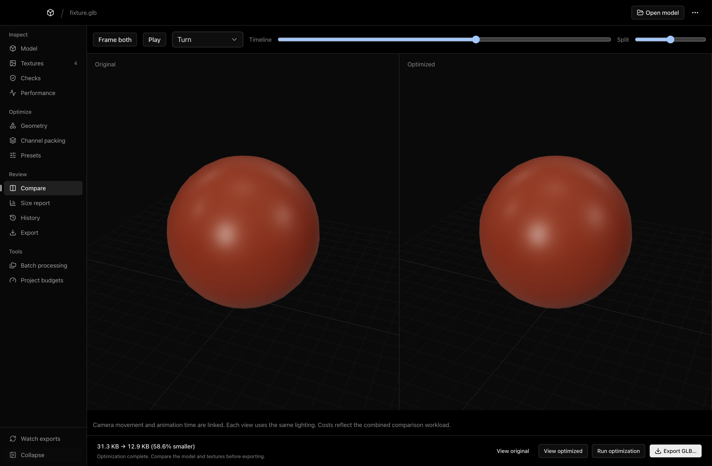

# GLB Viewer

A macOS desktop workspace for inspecting, debugging, comparing, and optimizing GLB and glTF assets before using them in Three.js. Built with Electron, React, TypeScript, Three.js, and [shadcn/ui](https://ui.shadcn.com/). Models and their resources stay local; decoders and the studio environment are bundled for offline use.

[Download the latest release](https://github.com/cullenwebber/glb-viewer/releases/latest) · [Build status](https://github.com/cullenwebber/glb-viewer/actions)

## Install

Choose the **arm64** DMG for Apple Silicon or **x64** for Intel, open it, and copy GLB Viewer to Applications. Builds are not notarized by Apple yet, so macOS warns on first launch: open **System Settings → Privacy & Security** and click **Open Anyway**. Updates are installed manually from the releases page; presets, budgets, and history are retained.

## Run

Requires Node.js 22.12+ and npm.

```sh
npm install
npm run desktop
```

For development with hot reload, run `npm run desktop:dev`. `npm run dev` starts the browser version at http://127.0.0.1:5173.

## Navigation

- **Inspect:** model, textures, materials, checks, and performance.
- **Optimize:** geometry, channel packing, and presets.
- **Review:** comparison, size report, history, and export.
- **Tools:** batch processing and project budgets.
- Drag the dividers beside the scene tree, inspector, texture library, or texture properties to change their widths. Widths are remembered between app sessions. Focus a divider and use arrow keys for keyboard resizing; double-click either divider to reset that workspace.
- All tools stay listed in the left navigation. Its optional compact mode is remembered between sessions. Use the ellipsis app menu for updates and keyboard shortcuts; file watching is in the navigation footer.

## Use

- Open a `.glb` or `.gltf` using **Open model**, **⌘O**, drag and drop, or Finder’s **Open With → GLB Viewer** after installing the app.
- Keep a glTF file’s buffers and textures inside its directory or subdirectories. Relative paths are preserved. Network resources and resources outside the selected model directory are blocked.
- Drag to orbit, scroll to zoom, and right drag to pan. Select any mesh or object in the scene tree to frame and highlight it; **F** frames the selection. **Escape** or **Clear selection** restores its original materials. Live model and viewport draw-call counts appear in the inspector; the viewport total includes the grid and selection bounds.
- Inspect the scene hierarchy, triangle and vertex counts, meshes, materials, textures, and dimensions. Dimensions use glTF’s meter convention; animated bounds reflect the pose at load time. Counts describe the loaded scene, rather than a performance budget or glTF validation report.
- Use the animation picker, play/pause button, scrubber, and playback speed controls. **Space** toggles playback. Clips loop.
- Adjust wireframe, grid, background, studio/ambient/directional lighting, exposure, and auto rotation.
- In **Geometry inspection**, show blue vertex normals or amber face normals, adjust their length relative to the model, and filter them to a selected object. Up to 5,000 normals are sampled on dense assets. Vertex normals follow skinning and morph targets; face normals follow the deformed triangles. Show bone connections during animation and scrubbing, with an optional in-front mode for both overlays. These helpers affect only the viewport and its draw-call total; they are excluded from the asset, model draw calls, and exports.
- Save a PNG of the viewport or copy a Three.js loader snippet. Move your model and any external resources into your Three.js project’s public directory; copy the bundled decoders into that project too.

The initial knot sculpture is a procedural demo. Opening a file replaces it. Draco, Meshopt, and KTX2 compression are supported. Other format extensions depend on Three.js GLTFLoader support.

In the browser version, select a GLB or select the glTF plus its resources together. For nested resources, drop the complete model folder. If a dropped folder contains several models, the first discovered model opens.

## Texture workbench

Use the **Textures**, **Channel packing**, and **Size report** tabs in the main workspace. The **Optimize** action opens the size report and export controls.

- Inspect every embedded or referenced image, including unassigned images. Sort by encoded size, inspect material slots, UVs, samplers, dimensions, and color/data roles.
- View RGBA, RGB, or individual R/G/B/A channels, flip Y, and inspect sampled pixel values. Scroll to zoom around the pointer, drag to pan, enter a zoom percentage, or use the zoom buttons. Double-click or press **Fit** to reset the texture view. PNG/JPEG/WebP/AVIF and KTX2 previews are supported; the debugger preview is capped at 2048 pixels.
- Set each image’s maximum resolution and output encoding separately. For example, keep a base-color image at 4096 px and resize a roughness/metalness image to 1024 px. Shared images affect all their material references. Resizing preserves aspect ratio and never upscales.
- The image list flags changed output settings as **Configured**, with a progress count and filters for configured, unchanged, and removed images. This means settings have been chosen, not that optimization has run or saved bytes. **Reset output settings** clears the flag. These choices are saved with the model’s recipe.
- Select **Remove from optimized model** to omit an image and all of its material assignments from the next optimization. The list shows **Remove on export**; **Keep this texture** restores its previous settings. Run optimization again to update the preview and export. Original files and material factors are preserved. Images used by packing recipes must be removed from those recipes first. If a Blender shader graph could restore the deleted image, the affected material falls back to its remaining glTF material and the report explains the change. Removal presets apply only to matching image identities, never merely to a matching texture role on another model.
- Choose PNG, JPEG, WebP, or KTX2 with ETC1S/UASTC. Configure PNG compression level, JPEG/WebP quality, WebP effort and lossless mode, ETC1S quality and effort, UASTC effort and RDO strength, and optional mipmaps per image or packing recipe. JPEG conversion rejects transparency. KTX2 preserves color/data transfer metadata and requires dimensions divisible by four. Existing KTX2 images can be inspected and preserved; reimport original raster images to resize or pack them.
- Create channel-packing recipes using model images or **Import texture files**. Choose any source channel or an 8-bit constant for each output channel. The ORM preset uses R = occlusion, G = roughness, and B = metalness. Bind a recipe to a material’s ORM, base-color, emissive, or normal slot. Sources are resampled to the chosen square resolution. Material factors and existing UV/sampler settings are retained; mismatched ORM UVs, transforms, or samplers are rejected. Imported files are packing inputs and enter the output model only through a recipe.
- Compress geometry with Draco or Meshopt, independently of texture choices. Use the settings button beside Geometry to adjust Draco position/normal/UV precision and encode/decode speed, or select Meshopt medium/high compression. Every run starts from the original document, avoiding cumulative lossy recompression.
- Compare actual source and output bytes for the full model and individual images. Model input size includes unique referenced external files. Texture rows describe encoded payload, not GPU memory. Duplicate references can appear in multiple image rows; the geometry/container remainder includes JSON, padding, and animation data.
- Preview the optimized model in Three.js, switch back to the original, then export a new self-contained GLB. Download individual displayed textures or the JSON size report. The original model is never overwritten.

Optimization runs in a background worker in the Mac app, and can be cancelled. All encoders are bundled; no system `toktx` installation or online service is required. Models using extensions unsupported by glTF Transform remain viewable but cannot be optimized safely.

## Blender to Three.js workflow

- **Checks** runs the official glTF Validator and checks transforms, normals, texture UV sets, and required extension support. Filter issues by severity, jump to affected objects, or export the validation report. Choose source or optimized output for validation. For unused UVs, queue unused-attribute cleanup; for double-sided materials, queue per-primitive single-sided fixes. Run optimization, review backface appearance, then validate the optimized output. Shared materials are isolated so other primitives keep their intended backface rendering. The original remains intact.
- **Performance** shows live frame intervals, CPU render submission time, model draw calls, per-mesh costs, geometry and texture memory estimates, and source-read, decode, compilation, and first-render timings. Frame or isolate individual meshes. Temporarily disable transparency, transmission, or shadows and adjust pixel ratio to compare rendering costs. These experiments do not change exported materials. Memory is estimated; CPU timings are not GPU timings or predictions for another device.
- **Geometry** adds global and per-mesh simplification targets, maximum error, border locking, and protected meshes. Optional cleanup deduplicates resources, prunes unused data, removes unused attributes, or resamples animation. Joining compatible meshes and instancing repeated meshes can reduce draw calls. Named objects are preserved by default; review application references before changing that setting. Instancing is skipped for animated models, and simplification skips skinned and morph-target meshes.
- Generate additional **LOD exports** at lower triangle targets. Error limits can prevent reaching a requested target, and protected meshes retain their geometry. LOD files are included in the Three.js bundle; choose switching distances and animation synchronization in your application.
- Enable **Watch** after opening a model to reload stable Blender re-exports, including atomic file replacements and changes to referenced resources. The camera and optimization recipe are retained. Export into the same location to keep the loop running.
- **Presets** saves named recipes locally, with rename, delete, and JSON import/export. Recipes include compression, geometry, texture rules, and channel packing. Matching uses texture identities, material names, and unambiguous texture roles rather than numeric indices. Missing or ambiguous matches are reported. Presets store rules rather than image binaries; reimport external packing inputs when unavailable. Each source also restores its last recipe automatically.
- **Export** saves either a self-contained optimized GLB or a complete Three.js bundle containing the model, generated LODs, offline decoders, a TypeScript loader with animation/disposal helpers, asset metadata, and the optimization report. Its README explains where to copy the assets and how to configure URLs. Export requires a successful optimization with current settings.

## Inspection and comparison

Use **Surface inspection** in the model inspector to solo base color, roughness, metalness, AO, alpha, the normal map, or geometry normal directions. **Face orientation** shows front faces blue and back faces red. **UV checker** uses the selected UV set; **Inspect UV layout** opens a pan/zoom layout with a checker or the first material's raster base-color texture. UV edges show exported triangles, with dense layouts sampled to 50,000 triangles. Missing UV sets are identified.

Choose **Bone weights**, then select a bone from the dropdown, scene tree, or visible joint in the viewport. Blue means zero weight and red means full influence. Bone overlays follow animation. The **Cost heatmap** compares meshes by triangle count, material slots, or estimated texture memory. Shared texture memory is counted for each mesh that references it; heatmap colors are relative to the current asset.

**Compare** loads original and optimized assets side by side with linked orbit, zoom, pan, and animation time. Use the split control to resize the views, or scrub their shared timeline. A comparison uses additional GPU memory for both assets.



## History, budgets, and batch work

Each successful optimization saves a local output snapshot and recipe in **History**. Rename or delete runs, restore their settings and exported bytes, or select two runs for visual comparison. History remains on disk until deleted. Restored outputs are historical snapshots; rerunning uses the current source file.

**Budgets** stores named limits for model bytes, texture memory, triangles, and draw calls. Zero disables a limit. The panel labels the asset currently measured in the viewport. Live rendering costs depend on camera, visibility, and display settings; memory values are estimates.

In **Batch**, select a saved preset, an optional project budget, and a folder of models. Choose an output folder when starting. Jobs run sequentially in a separate worker, preserve source files, validate each output, and continue past individual failures. Each successful model gets a GLB and JSON report, alongside `batch-report.json`. Cancellation keeps completed outputs. Batch draw calls estimate primitive counts; texture memory estimates RGBA8 mipmaps. Review skipped or ambiguous preset rules in the reports, especially when channel packing depends on external inputs.

## Three.js and React Three Fiber

The **Materials** workspace adds an interactive, supported-node TSL editor with live model preview, magnetic socket snapping, procedural noise nodes, physical glass/coat/sheen inputs, graph import/export, and standalone material TypeScript exports. The viewer uses WebGPU with a WebGL 2 fallback backend. Install the Blender bridge from **Export** to send embedded material graphs, cameras, and Point/Spot/Sun lights through the existing export watcher. The viewport camera selector lets you look through imported cameras; **Scene lights** toggles imported lighting, and **Camera/light helpers** shows their guides. See [Blender bridge and node editor](blender-bridge.md) for installation, supported nodes, shortcuts, and current limitations. Editor drafts are separate from the optimized GLB's original materials.

The **Export** bundle includes `load-model.ts`, `model-types.ts`, and an optional `Model.tsx` component, plus matching decoder assets and dependency fragments. Typed lookups use glTF node indices, so names sanitized by Three.js still resolve correctly. Duplicate source names are excluded from named lookups. Animation names are typed too.

The R3F component renders inside your own `Canvas`, supports animation and playback props, reports loading errors, and disposes its owned model on unmount. See the generated bundle README for paths and setup. Lighting and LOD distances remain application choices.

## Releases and app updates

Tagged versions build Apple Silicon and Intel DMG/ZIP downloads through GitHub Actions. Signed releases support user-controlled download/restart updates; unsigned builds open the release page for manual installation. Apple signing/notarization credentials are not included in this repository. See [release setup](releasing.md) for the required GitHub secrets and publishing steps.

## Code organization

- `src/components/ui/`: official shadcn/ui components, configured by `components.json`.
- `src/components/layout/`: app header, scene sidebar, keyboard help.
- `src/components/viewer/`: viewport, playback, model details, display and lighting controls.
- `src/components/workbench/`: image library, pixel debugger, texture properties, packing editor, size report, and workspace.
- `src/components/checks/`, `performance/`, `presets/`, and `export/`: validation, rendering diagnostics, recipe library, and bundle export.
- `src/hooks/`: viewer lifecycle and workbench state/actions.
- `src/viewer/`: Three.js rendering and file resolution, independent of React components.
- `electron/`: local file permissions, background optimization and export.
- `electron/pipeline/`: validation, geometry transforms, persistent recipes, file watching, and Three.js bundle generation.

The UI uses sentence-case labels, tight `-0.02em` letter spacing, and shadcn’s shared theme tokens. Its workspace-first layout, neutral surfaces, white primary actions, compact property rows, and persistent tabs are described in `docs/design-direction.md`.

## Build a Mac app

```sh
npm run package:mac  # release/mac-arm64/GLB Viewer.app on Apple Silicon
npm run dist:mac     # creates a DMG in release/
```

Builds target the current Mac’s architecture. Use `npx electron-builder --mac --arm64 --x64` after `npm run build` to build both architectures. Local builds are unsigned unless a Developer ID signing identity is configured. Distribution outside your Mac needs signing and notarization.

## Verify

```sh
npm test
```

Builds and type-checks the renderer, tests the optimization engine with round-trip decoding and pixel checks, then runs Electron integration tests for the viewer and workbench. Coverage includes external resources, per-texture resizing, Draco/Meshopt, ETC1S/UASTC color metadata and mipmaps, channel packing, imported maps, size accounting, native export, optimized Three.js previews, and error recovery. Tests create temporary fixtures and remove them afterward.

Pipeline tests also cover validation, simplification and protected meshes, LOD decoding, instancing, animation cleanup, recipe matching across reordered assets, persistent presets, complete export bundles, and atomic Blender re-exports with recipe restoration across app restarts. Set `SMOKE_APP_PATH` to the packaged app's executable to run Electron integration tests against a release build.

## Three.js example

```js
import { GLTFLoader } from "three/addons/loaders/GLTFLoader.js";

const gltf = await new GLTFLoader().loadAsync("/models/model.glb");
scene.add(gltf.scene);
```

For compressed assets, use the viewer’s **Copy loader snippet** action to include Draco, KTX2, and Meshopt setup. Set the KTX2 loader’s renderer to your own WebGLRenderer.

References: [Three.js GLTFLoader](https://threejs.org/docs/pages/GLTFLoader), [Electron security guidance](https://www.electronjs.org/docs/latest/tutorial/security).
